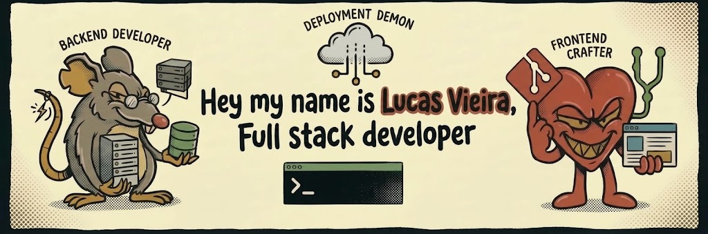

 

# >_ Ah, Hello! 
Meu nome é Lucas Vieira,sou um Desenvolvedor Full Stack brasileiro de 24 anos. Minha jornada na tecnologia começou aos 19 anos com a manutenção de hardware, mas em 2023 decidi redirecionar minha carreira para o desenvolvimento de software. Atualmente, construo projetos pessoais com as tecnologias que mais me fascinam

## >_ About Me
- 🎓 **Formação:** _(Gestão de T.I / FATEC)_
- 💼 **Estágio:** PROATI — suporte técnico, desenvolvimento e gestão de dispositivos
- 🌱 **Estudando agora:** _(Java, C++, Js)_
- 🔥 **Meta:** programar todos os dias e manter a sequência de contribuições

## >_ Statistics

